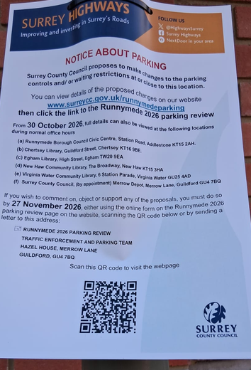

# Runnymede Parking Review 2026 (Unofficial site)

Surrey County Council is proposing a number of new parking controls and restrictions across Runnymede. This site lets residents explore each proposal and find out how to comment on it. It is not affiliated with Surrey County Council and uses only publicly available information from the [Surrey County Council website](https://www.surreycc.gov.uk/roads-and-transport/parking/reviews/runnymede/runnymede-parking-review-2026).

**Site: <https://andrewl.github.io/unofficial-runnymede-parking-review/>**

## Why this site exists

This site was built by a local resident after seeing a generic notice about parking changes on a lamp post nearby. The notice explained that changes were proposed "at or close to this location", and pointed to a website, with a QR code, for more information.

Finding out what was actually proposed for my street took some digging:

- the written proposal was inside one large PDF, the Statement of Reasons, covering the whole borough;
- the map or drawing for each proposal was in a different PDF, and there were several of these for each area;
- the link to comment was on a separate website altogether.

This site aims to make that easier. It gives each proposal its own page, bringing together the proposal details, the associated drawing and a link to the online feedback form, so that residents can explore the proposals that matter to them without searching through multiple files. The proposals can also be found on a map on the homepage.

The aim is to improve transparency and encourage more residents to take part, whether they support a proposal, object to it, or have other comments.
